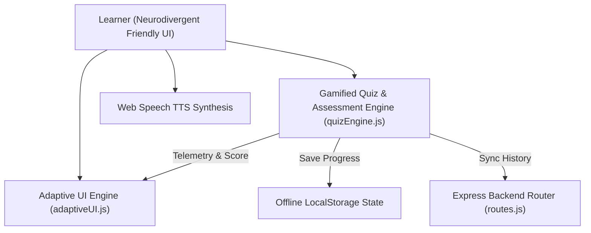

# VidhyaPath – Adaptive Inclusive E-Learning Platform
### Viksit Bharat 2047 | NEP 2020 & Skill India

Adaptive e-learning platform dynamically tailoring visual complexity, typography, and pacing for neurodivergent learners.

[Live Demo](TODO: add live link) | [License](LICENSE)

---

## Features
- **Dynamic Neurodivergent Adaptability:** Automatically shifts visual complexity, color contrast, and layout density based on student focus and quiz interaction metrics.
- **Accessibility & Dyslexia Modes:** Toggleable OpenDyslexic typography, high-contrast themes, and customizable letter spacing to reduce visual crowding.
- **Built-in Speech Synthesis (TTS):** Browser Web Speech API integration providing real-time multi-speed audio narration for lessons and questions.
- **Gamified Micro-Learning:** Interactive adaptive quizzes with positive reinforcement, instant feedback loops, and visual streak milestones.
- **Student Performance Analytics:** Chart.js visual telemetry tracking subject mastery, comprehension speed, and focus duration over time.

## Tech Stack
- **Frontend:** HTML5, CSS3 (Custom Design Tokens & Accessibility Sheets), Vanilla JavaScript (ES6+), Chart.js
- **Backend:** Node.js, Express, REST APIs
- **Storage:** LocalStorage (Offline Cache), Express API persistence
- **Accessibility Standards:** WCAG 2.1 AA Compliance, Web Speech API

## Architecture



## Getting Started

### Prerequisites
- Node.js 18+ (optional, runs directly in any modern web browser)

### Option 1: Zero-Install Quick Start (Browser Only)
1. Clone the repository:
   ```bash
   git clone https://github.com/yashpatadiya1724-cmyk/vidhyapath.git
   cd vidhyapath
   ```

2. Open `index.html` directly in any web browser (Chrome, Edge, Firefox, Safari).

### Option 2: Running with Node.js & Express API
1. Install backend dependencies:
   ```bash
   npm install
   ```

2. Copy environment template:
   ```bash
   cp .env.example .env
   ```

3. Launch server:
   ```bash
   npm start
   ```
   Open `http://localhost:3000` in your browser.

## API Endpoints

| Method | Endpoint | Description |
|---|---|---|
| `GET` | `/` | Serve main interactive learning portal |
| `GET` | `/api/lessons` | Retrieve available curriculum lessons |
| `GET` | `/api/quizzes` | Fetch adaptive quiz question sets |
| `POST` | `/api/progress` | Submit and sync student performance milestones |

## Security and Privacy
- **Privacy by Default:** Student learning paces, dyslexia settings, and quiz answers are stored locally on the learner's device (LocalStorage) without mandatory tracking.
- **Accessible Design:** No sudden flashing elements or sensory-overloading animations, adhering to safe guidelines for learners with sensory sensitivities.
- **Known Limitations:** Voice synthesis quality depends on native OS-installed speech voices; offline mode syncs to API only when an active network is detected.

## Roadmap
- [x] Adaptive UI complexity switching
- [x] Dyslexia-friendly typography and high-contrast modes
- [x] Web Speech API narration
- [ ] Multilingual regional voice synthesis (Hindi, Gujarati, Tamil)
- [ ] Eye-tracking integration via WebGazer.js for automated attention fatigue detection

## What I Learned
- Accessibility is not just an add-on; building software that automatically adjusts its visual layout and pacing empowers neurodivergent learners to thrive without feeling singled out.
- Combining local browser storage with zero-dependency vanilla JavaScript provides instant, flicker-free learning on low-power tablets in rural schools.

## License
MIT
